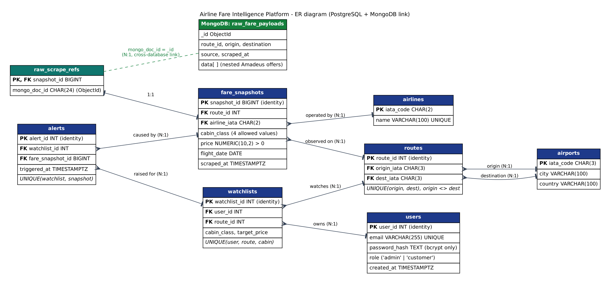
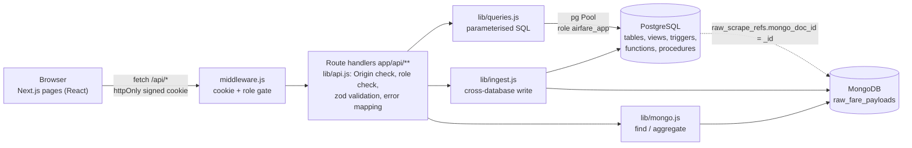
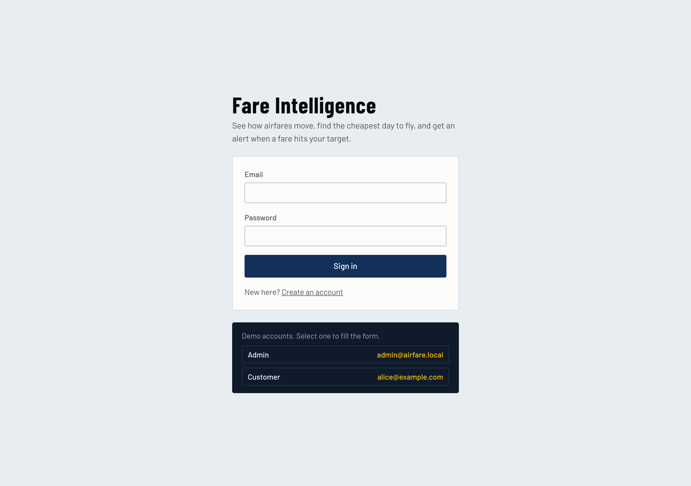
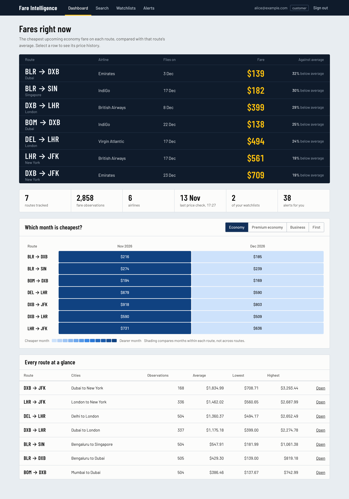
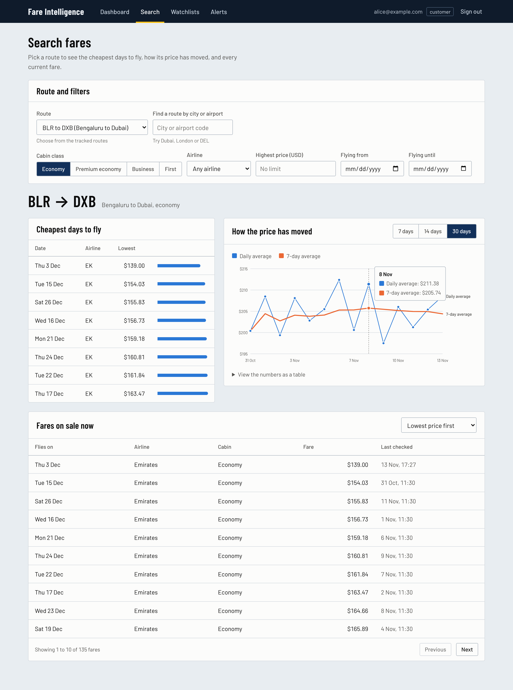
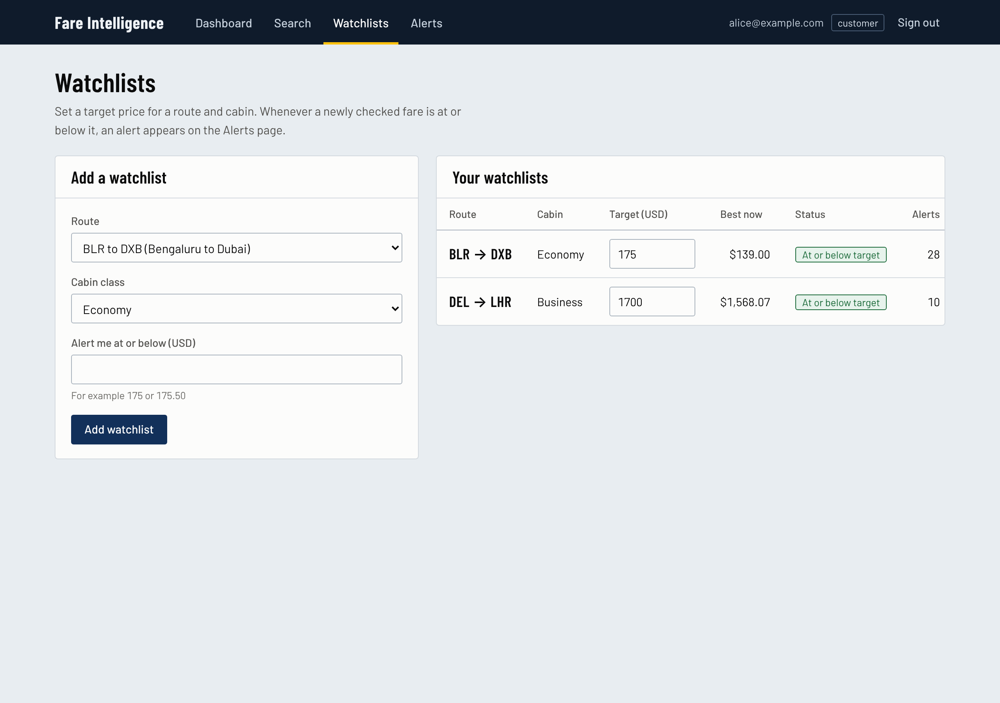
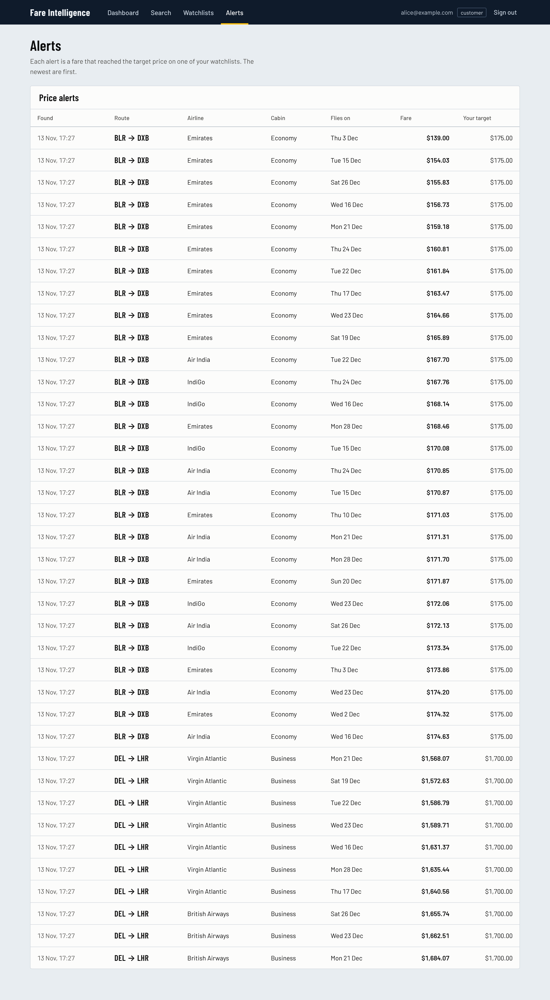
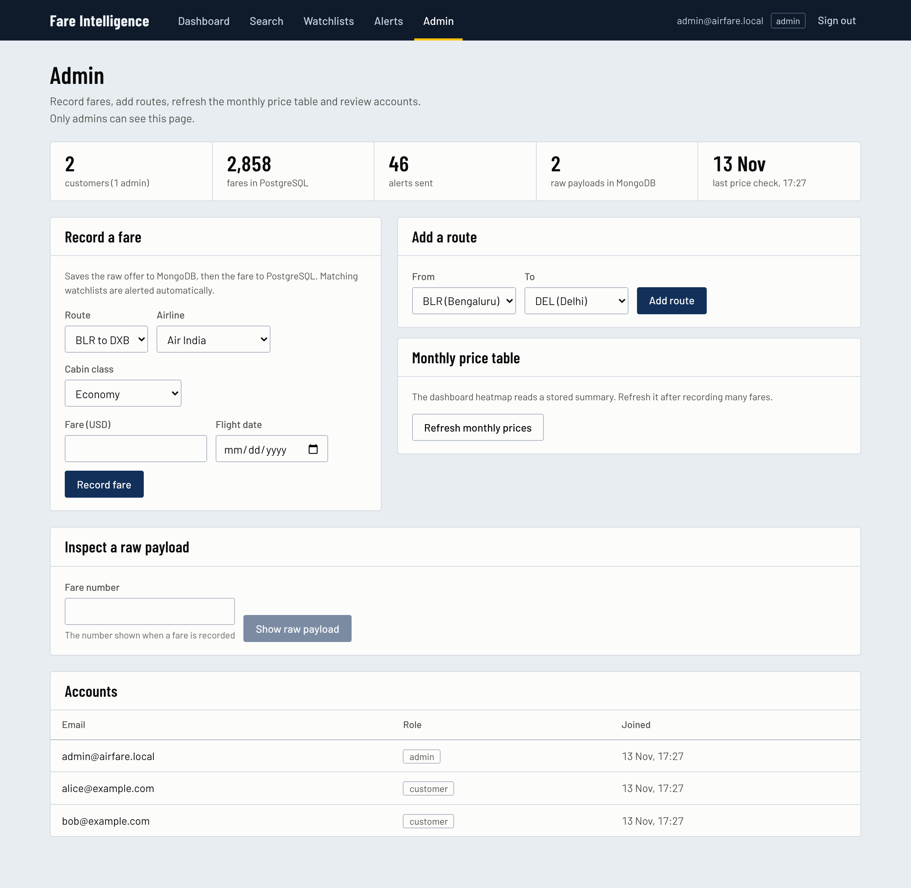
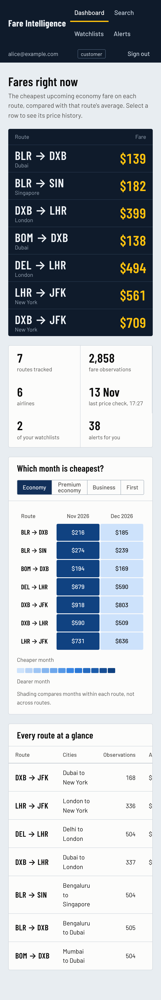
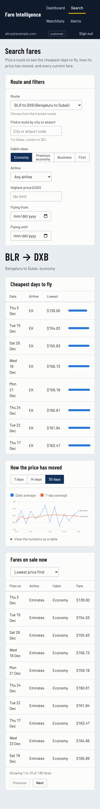

# Airline Fare Intelligence Platform: Project Documentation

DBMS Experiential Learning, Level 3 Project - PES University

| Name | SRN |
|---|---|
| Maniish Rajendran | PES2UG24CS265 |
| Mueez Ahmed | PES2UG24CS286 |

## Contents

1. Problem statement
2. Objectives
3. Scope
4. Functional requirements
5. ER diagram
6. Relational schema
7. Database choice and justification
8. Data dictionary
9. Database implementation (SQL, NoSQL)
10. Important queries
11. System architecture
12. Application screenshots
13. Testing
14. Individual contributions
15. Conclusion and future enhancements

---

## 1. Problem statement

Airline prices for the same route change daily and depend on how far ahead you book, the day of the week, the cabin and
the airline. A traveller looking at one price has no way to know whether it is a good one. Price history exists, but it is
scattered and not easy to compare.

This project builds a **fare intelligence platform**: it stores a time series of fare observations for a set of routes,
analyses them (averages, trends, cheapest dates, month-by-month comparison), and notifies a user automatically when a fare
reaches a target price they set. The raw flight-offer data returned by the airline-data source (Amadeus-style JSON) is kept
untouched in a document database, while the normalised prices live in a relational database.

## 2. Objectives

1. Design a normalised relational schema with full integrity constraints for fare, route, user and alert data.
2. Keep the raw, nested, variable-shape offer JSON in a NoSQL store and link it to the relational rows.
3. Push logic into the database where it belongs: triggers for alerts, stored procedures for atomic ingestion, functions and a materialized view for analytics.
4. Provide a Next.js web application with role-based access (admin, customer) that exposes this functionality.
5. Enforce data validation at the database level and follow basic database and web security practice.

## 3. Scope

**In scope:** fare history for tracked routes; search and filter; cheapest-date and trend analytics; monthly heatmap;
watchlists and trigger-generated alerts; admin recording of fares and routes; raw-payload inspection and MongoDB aggregation;
registration, login and two roles.

**Out of scope:** booking or payment; live crawling of airline sites (the data is a synthetic Amadeus-shaped sample, the ingest
path accepts the same structure a real scraper would produce); email or SMS delivery of alerts (alerts are rows shown in the app);
vector search (the data is numeric and structured, see section 7).

## 4. Functional requirements

| ID | Requirement | Role |
|---|---|---|
| F1 | Register as a customer, sign in, sign out | anyone |
| F2 | Dashboard: cheapest upcoming economy fare per route vs route average, headline counts, monthly heatmap by cabin, route overview | customer, admin |
| F3 | Search fares by route with filters (cabin, airline, max price, date range), sorting and pagination | customer, admin |
| F4 | Find a route by city or airport code (full-text search) | customer, admin |
| F5 | Cheapest days to fly on a route; price trend with 7-day moving average and day-over-day change | customer, admin |
| F6 | Create, edit and delete own watchlists (route + cabin + target price) | customer, admin |
| F7 | Automatic alert when a newly recorded fare is at or below a watchlist target; alert inbox | customer, admin |
| F8 | Record a fare (writes MongoDB raw payload and PostgreSQL snapshot atomically from the user's view) | admin |
| F9 | Add a route | admin |
| F10 | Refresh the monthly price materialized view | admin |
| F11 | Inspect the raw MongoDB payload behind any fare | admin |
| F12 | Run MongoDB aggregations over the raw payloads (carrier averages, stops, low availability) | admin |
| F13 | List accounts (never shows password hashes) | admin |

Non-functional: passwords stored only as bcrypt hashes; least-privilege database account; parameterised SQL only; input validated
in the app and again by the database; no credentials in source.

## 5. ER diagram



Source: `er_diagram.dot` (Graphviz), vector copy `er_diagram.svg`.

Relationships:

| Relationship | Cardinality | Implemented by |
|---|---|---|
| route - origin airport | N:1 | `routes.origin_iata` -> `airports` |
| route - destination airport | N:1 | `routes.dest_iata` -> `airports` |
| fare snapshot - route | N:1 | `fare_snapshots.route_id` -> `routes` |
| fare snapshot - airline | N:1 | `fare_snapshots.airline_iata` -> `airlines` |
| fare snapshot - raw payload reference | 1:1 | `raw_scrape_refs.snapshot_id` is both PK and FK |
| raw payload reference - MongoDB document | N:1 | `raw_scrape_refs.mongo_doc_id` = MongoDB `_id` (several fares can come from one batch document) |
| watchlist - user | N:1 | `watchlists.user_id` -> `users` |
| watchlist - route | N:1 | `watchlists.route_id` -> `routes` |
| alert - watchlist | N:1 | `alerts.watchlist_id` -> `watchlists` |
| alert - fare snapshot | N:1 | `alerts.fare_snapshot_id` -> `fare_snapshots` |

(user - fare is not a direct relationship; users relate to fares only through watchlists and alerts, which makes `users` and
`routes` many-to-many through `watchlists`.)

## 6. Relational schema

Primary keys are underlined with `_`, foreign keys are marked with `->`.

```
airports        ( _iata_code_ CHAR(3), city, country )
airlines        ( _iata_code_ CHAR(2), name UNIQUE )
routes          ( _route_id_, origin_iata -> airports, dest_iata -> airports,
                  UNIQUE(origin_iata, dest_iata), CHECK(origin_iata <> dest_iata) )
users           ( _user_id_, email UNIQUE, password_hash, role, created_at )
fare_snapshots  ( _snapshot_id_, route_id -> routes, airline_iata -> airlines,
                  cabin_class, price, flight_date, scraped_at,
                  UNIQUE(route_id, airline_iata, cabin_class, flight_date, scraped_at) )
raw_scrape_refs ( _snapshot_id_ -> fare_snapshots, mongo_doc_id )
watchlists      ( _watchlist_id_, user_id -> users, route_id -> routes,
                  target_price, cabin_class, UNIQUE(user_id, route_id, cabin_class) )
alerts          ( _alert_id_, watchlist_id -> watchlists, fare_snapshot_id -> fare_snapshots,
                  triggered_at, UNIQUE(watchlist_id, fare_snapshot_id) )
```

Normalisation: every table is in 3NF. Airport and airline names are stored once and referenced by code; fare facts depend only on
the snapshot key; alert facts depend only on the alert key. `raw_scrape_refs` is split from `fare_snapshots` so the relational
table does not carry a column that only matters to the NoSQL side.

Referential actions: deleting a route or watchlist cascades to the rows that depend on it (`ON DELETE CASCADE` for
fare_snapshots, watchlists, alerts, raw_scrape_refs); airports and airlines that are in use cannot be deleted (`RESTRICT`).

## 7. Database choice and justification

| Data | Database | Justification |
|---|---|---|
| Users, roles, airports, airlines, routes | PostgreSQL | Small, structured reference data with strict relationships and uniqueness. |
| Fare snapshots (time series) | PostgreSQL | Heavy analytical use: joins, GROUP BY, window functions (moving average, LAG, RANK), materialized view, composite index on (route, date, cabin). Needs `CHECK price > 0` and FK integrity. |
| Watchlists and alerts | PostgreSQL | Alerts are produced by an `AFTER INSERT` trigger in the same transaction as the fare. Only a relational engine gives this guarantee. |
| Raw Amadeus flight-offer payloads | MongoDB | Deeply nested (`offers -> itineraries -> segments`, `travelerPricings -> fareDetailsBySegment`) with a shape that varies per offer (nonstop vs connecting, optional `fareRules`, carrier-specific baggage fields). Forcing this into columns would discard information before it is needed. A document store keeps it exactly as received, supports a schema validator for the fields we rely on, indexes on nested fields, TTL expiry, and an aggregation pipeline over the nested arrays. |
| Vector database | not used | There is no text or embedding-worthy unstructured data. The brief marks this optional and asks that a database is not added only for demonstration. |

PostgreSQL is mandatory in the brief and is the system of record. MongoDB is justified by the shape of the data, not by the brief.

## 8. Data dictionary

### PostgreSQL

**airports**

| Column | Type | Constraints |
|---|---|---|
| iata_code | CHAR(3) | PK, `CHECK ~ '^[A-Z]{3}$'` |
| city | VARCHAR(100) | NOT NULL |
| country | VARCHAR(100) | NOT NULL |

**airlines**

| Column | Type | Constraints |
|---|---|---|
| iata_code | CHAR(2) | PK, `CHECK ~ '^[A-Z0-9]{2}$'` |
| name | VARCHAR(100) | NOT NULL, UNIQUE |

**routes**

| Column | Type | Constraints |
|---|---|---|
| route_id | INT identity | PK |
| origin_iata | CHAR(3) | NOT NULL, FK airports, ON UPDATE CASCADE, ON DELETE RESTRICT |
| dest_iata | CHAR(3) | NOT NULL, FK airports, ON UPDATE CASCADE, ON DELETE RESTRICT |
| | | `uq_route_pair` UNIQUE(origin, dest); `chk_route_not_self` origin <> dest |

**users**

| Column | Type | Constraints |
|---|---|---|
| user_id | INT identity | PK |
| email | VARCHAR(255) | NOT NULL, UNIQUE, `chk_user_email` regex |
| password_hash | TEXT | NOT NULL, `chk_user_bcrypt` must match a bcrypt hash, so plaintext cannot be stored |
| role | VARCHAR(10) | NOT NULL, default `customer`, `chk_user_role` IN (admin, customer) |
| created_at | TIMESTAMPTZ | NOT NULL, default now() |

**fare_snapshots**

| Column | Type | Constraints |
|---|---|---|
| snapshot_id | BIGINT identity | PK |
| route_id | INT | NOT NULL, FK routes, ON DELETE CASCADE |
| airline_iata | CHAR(2) | NOT NULL, FK airlines, ON DELETE RESTRICT |
| cabin_class | VARCHAR(20) | NOT NULL, `chk_fare_cabin` IN (economy, premium_economy, business, first) |
| price | NUMERIC(10,2) | NOT NULL, `chk_fare_price` > 0 |
| flight_date | DATE | NOT NULL |
| scraped_at | TIMESTAMPTZ | NOT NULL, default now() |
| | | `uq_fare_observation` UNIQUE(route, airline, cabin, flight_date, scraped_at) added with ALTER TABLE |

**raw_scrape_refs**

| Column | Type | Constraints |
|---|---|---|
| snapshot_id | BIGINT | PK, FK fare_snapshots, ON DELETE CASCADE |
| mongo_doc_id | CHAR(24) | NOT NULL, `chk_mongo_oid` ~ '^[0-9a-f]{24}$' |

**watchlists**

| Column | Type | Constraints |
|---|---|---|
| watchlist_id | INT identity | PK |
| user_id | INT | NOT NULL, FK users, ON DELETE CASCADE |
| route_id | INT | NOT NULL, FK routes, ON DELETE CASCADE |
| target_price | NUMERIC(10,2) | NOT NULL, `chk_watch_price` > 0, `chk_watch_price_cap` < 1,000,000 (added with ALTER) |
| cabin_class | VARCHAR(20) | NOT NULL, `chk_watch_cabin` |
| | | `uq_watch` UNIQUE(user, route, cabin) |

**alerts**

| Column | Type | Constraints |
|---|---|---|
| alert_id | INT identity | PK |
| watchlist_id | INT | NOT NULL, FK watchlists, ON DELETE CASCADE |
| fare_snapshot_id | BIGINT | NOT NULL, FK fare_snapshots, ON DELETE CASCADE |
| triggered_at | TIMESTAMPTZ | NOT NULL, default now() |
| | | `uq_alert` UNIQUE(watchlist, snapshot) |

**Views:** `v_users_public` (users without the hash), `v_latest_fares` (newest price per route/airline/cabin/date via `DISTINCT ON`),
`v_route_overview` (route names plus count/avg/min/max).
**Materialized view:** `mv_monthly_route_heatmap` (route, month, cabin: count, avg, min, max), unique index `uq_mv_heatmap`.

### MongoDB: collection `raw_fare_payloads`

One document is one scrape batch for one route on one day (`_id` is the value stored in `raw_scrape_refs.mongo_doc_id`).

| Field | Type | Notes |
|---|---|---|
| `_id` | ObjectId | Link target of `raw_scrape_refs.mongo_doc_id` |
| `route_id` | int (>= 1) | Matches `routes.route_id` in PostgreSQL |
| `origin`, `destination` | string `^[A-Z]{3}$` | Denormalised for aggregation without a join |
| `source` | enum `amadeus` | |
| `scraped_at` | date | Drives the TTL index |
| `request` | object | Original search parameters (optional) |
| `meta.count` | int | Number of offers |
| `data[]` | array of offers | Each offer must have `itineraries` and `price{currency,total}`. May contain `numberOfBookableSeats`, `validatingAirlineCodes[]`, `itineraries[].segments[]`, `travelerPricings[].fareDetailsBySegment[]`, optional `fareRules` |

- **Schema validation:** `$jsonSchema` validator, `validationLevel: strict`, `validationAction: error` (data integrity on the NoSQL side).
- **Indexes:** `{route_id:1, scraped_at:-1}` (latest batches per route); `{data.validatingAirlineCodes:1}` (multikey, find by carrier);
  `{scraped_at:1}` with `expireAfterSeconds` = 90 days (TTL).
- **Embeddings:** none (no vector component).
- **Retrieval strategy:** by key. The app reads `raw_scrape_refs.mongo_doc_id` from PostgreSQL and calls `findOne({_id})`. Analytics use aggregation pipelines.

## 9. Database implementation

### 9.1 SQL (files in `database/`)

| Concept | Where |
|---|---|
| CREATE, ALTER, DROP, PK/FK, constraints | `01_schema.sql` (sections 0 to 2, and the create-alter-drop scratch table in section 4) |
| Indexes | `01_schema.sql` section 3: composite `(route_id, flight_date, cabin_class)`, `airline_iata`, `scraped_at DESC`, watchlist `(route_id, cabin_class)`, `alerts(watchlist_id)`, GIN full-text index on airports |
| Views | `01_schema.sql` section 5 |
| Materialized view | `02_advanced.sql` section 1 |
| Triggers | `trg_fare_check_watchlists` (AFTER INSERT on fare_snapshots, writes alerts), `trg_fare_immutable` (BEFORE UPDATE, historical fares cannot change) in `02_advanced.sql` |
| Functions | `get_cheapest_dates(route, cabin, days, limit)`, `get_price_trend(route, cabin, days)` (window functions: AVG OVER ROWS BETWEEN, LAG) |
| Procedures | `sp_record_fare_snapshot` (atomic fare + raw reference insert, fires the trigger), `sp_refresh_heatmap` |
| Transactions | `04_queries.sql` section F (COMMIT, automatic rollback on CHECK violation, explicit ROLLBACK); the procedure call is atomic; `lib/ingest.js` adds a compensating delete across the two databases |
| Full-text search | GIN index on `to_tsvector('simple', ...)` over the concatenated code, city and country, queried in `lib/queries.js` `findRoutesByText` |
| DML | `03_seed.sql` and `04_queries.sql` sections A to D |
| Access control | `06_app_security.sql`: role `airfare_app`, SECURITY DEFINER functions `fn_verify_login` / `fn_register_user`, grants, 12-check self-test |

Data validation at the database level: every column constraint in the data dictionary, plus the two triggers and the bcrypt-only
password check. `04_queries.sql` section G runs 12 hostile inserts (negative price, bad cabin, unknown airline, self-route,
duplicate route, plaintext password, malformed email, duplicate email, bad role, zero target, bad ObjectId, deleting a referenced
airline) and prints PASS/FAIL for each.

### 9.2 NoSQL (`database/05_mongo_setup.js`)

Validated collection, three indexes, 98 sample documents (7 routes x 14 scrape days), a `findOne` by the PostgreSQL link, and
four aggregation pipelines: average offered price per carrier per route; nonstop vs connecting counts; low-availability offers;
documents per scrape day. A final test confirms an invalid document is rejected by the validator. The same three analytical
pipelines run live in the web app (`lib/mongo.js` `rawPayloadInsights`, shown on the Admin page).

### 9.3 Cross-database write

`lib/ingest.js`: validate input -> look up the route in PostgreSQL -> insert the raw payload in MongoDB -> `CALL sp_record_fare_snapshot(...)`
in PostgreSQL (fare row + `raw_scrape_refs` row in one transaction, trigger fires) -> on any PostgreSQL error, delete the Mongo
document. If MongoDB is down the request fails with 503 before anything is written to PostgreSQL.

## 10. Important queries

All SQL the web app runs is in `webapp/lib/queries.js`. Report queries are in `database/04_queries.sql`. Highlights:

| Query | What it shows | Where |
|---|---|---|
| Q1 five-table JOIN + correlated subquery | cheapest upcoming economy fare per route | `04_queries.sql` |
| Q2 GROUP BY / HAVING / aggregates | routes with average above 300 and at least 100 observations | `04_queries.sql` |
| Q3 airline comparison with STDDEV | price volatility per airline on one route | `04_queries.sql` |
| Q5 CTE deal detection | today's fares at least 15% below the 30-day average | `04_queries.sql` |
| Q6 subquery with IN | customers watching routes that depart from India | `04_queries.sql` |
| Q7 LEFT JOIN + GROUP BY | each watchlist with its alert count (zeros included) | `04_queries.sql` |
| Q8 RANK() window | cheapest airline first within each route | `04_queries.sql` |
| Q9 full-text search | `to_tsquery` with the terms london OR dubai, using the GIN index | `04_queries.sql` |
| Q12 functions | `get_cheapest_dates`, `get_price_trend` | `04_queries.sql`, used by `/api/cheapest`, `/api/trend` |
| Dashboard board | `DISTINCT ON` per route over `v_latest_fares` joined to the route average | `lib/queries.js` `getDashboard` |
| Fare search | dynamic filters through `($n IS NULL OR col = $n)`, whitelisted ORDER BY, `COUNT(*) OVER ()` for pagination | `lib/queries.js` `searchFares` |
| EXPLAIN | proves the composite index `idx_fare_route_date_cabin` is used | `04_queries.sql` section E |
| Mongo pipelines | `$unwind`, `$group`, `$convert`, `$match`, `$project`, `$sort` | `05_mongo_setup.js` section 5, `lib/mongo.js` |

## 11. System architecture



Layers and security controls:

1. **Browser**: only calls `/api/*`; no database access.
2. **Middleware**: verifies the signed JWT cookie before any page or API runs; blocks `/admin` and `/api/admin` for non-admins.
3. **Route handlers**: Origin check on state-changing calls (CSRF), role check against the *database* on every request
   (a deleted or demoted user loses access immediately), zod validation, uniform error mapping (database constraint names become readable messages; no SQL or stack trace reaches the browser).
4. **Database access**: connects as `airfare_app`, which cannot read `users`, cannot update or delete fares, and cannot run DDL.
   Sign-in and sign-up run inside SECURITY DEFINER functions, so bcrypt hashes never leave PostgreSQL.
5. **Secrets**: `DATABASE_URL`, `MONGODB_URI`, `SESSION_SECRET` come from `.env.local` (git-ignored); the repo ships only `.env.example`.

Other security measures: bcrypt (pgcrypto, cost 10); login throttling (5 failures per IP+email and 20 per IP, 15 minutes);
identical message for unknown email and wrong password; CSP and security headers (`next.config.js`); self-registration can only create `customer`.

## 12. Application screenshots

| | |
|---|---|
| Sign in |  |
| Dashboard |  |
| Search |  |
| Watchlists |  |
| Alerts |  |
| Admin |  |
| Mobile dashboard / search |   |

The Admin screenshot predates the "Raw payload analytics (MongoDB aggregation)" panel; retake it before the demo so the panel is included.

## 13. Testing

| Suite | Command | Covers |
|---|---|---|
| End-to-end API | `cd webapp && npm test` (app must be running) | authentication, forged cookie, role-based access (customer vs admin), registration (weak password, duplicate, role escalation attempt), search filters and pagination, SQL-injection attempts in route, airline and sort parameters, watchlist CRUD and ownership (cannot touch another user's watchlist), CSRF (foreign Origin), admin route/fare ingestion across PostgreSQL + MongoDB, trigger-generated alert visible to the watchlist owner, raw payload lookup, MongoDB aggregation endpoint, heatmap refresh, brute-force throttling (429) |
| Database constraints | `psql -d airfare -f database/04_queries.sql` | section G: 12 rejected invalid inserts, B3 immutable fares, T1 to T3 transactions |
| Privilege self-test | printed by `06_app_security.sql` | the app role is refused 9 forbidden statements and allowed login, register and view access |
| MongoDB | `mongosh ... database/05_mongo_setup.js` | validator rejects a document without `data` |

Checks performed while preparing this repository: every JavaScript file in `webapp/` parses and all imports resolve; the validation
schemas (`lib/validation.js`), JWT session helpers (`lib/session-token.js`) and error mapping (`lib/errors.js`) were exercised with
32 unit assertions (all passed), including SQL-injection strings, tampered tokens and non-leaking 500 errors. The previous version
of the project reported 83 passing end-to-end checks against live PostgreSQL and MongoDB-compatible servers, and its
screenshots show the seeded database (2,858 fares). Re-run the suites on your machine and paste the final output below for the report.

```
(paste the output of `npm test` here)
```

## 14. Individual contributions

Edit this table to match the Git history before submission (the brief requires commits to show individual contributions).

| Area | Maniish Rajendran (PES2UG24CS265) | Mueez Ahmed (PES2UG24CS286) |
|---|---|---|
| Database | | |
| Application | | |
| Documentation / testing | | |

## 15. Conclusion and future enhancements

The platform shows a clear connection between database concepts and a working application: constraints and triggers enforce the rules,
stored procedures make ingestion atomic, window functions and a materialized view power the analytics, full-text search drives route
lookup, and MongoDB holds the data whose shape does not suit tables. Nothing in the UI is a thin CRUD screen over a table.

Future enhancements:

- Replace the synthetic loader with a scheduled job that calls the real Amadeus API.
- Deliver alerts by email or push notification.
- Partition `fare_snapshots` by month and refresh the materialized view on a schedule.
- Add a vector database for semantic search over fare rules or user reviews if text data is introduced.
- Per-request CSP nonce to remove `'unsafe-inline'`; Redis-backed login throttling for multiple instances.
